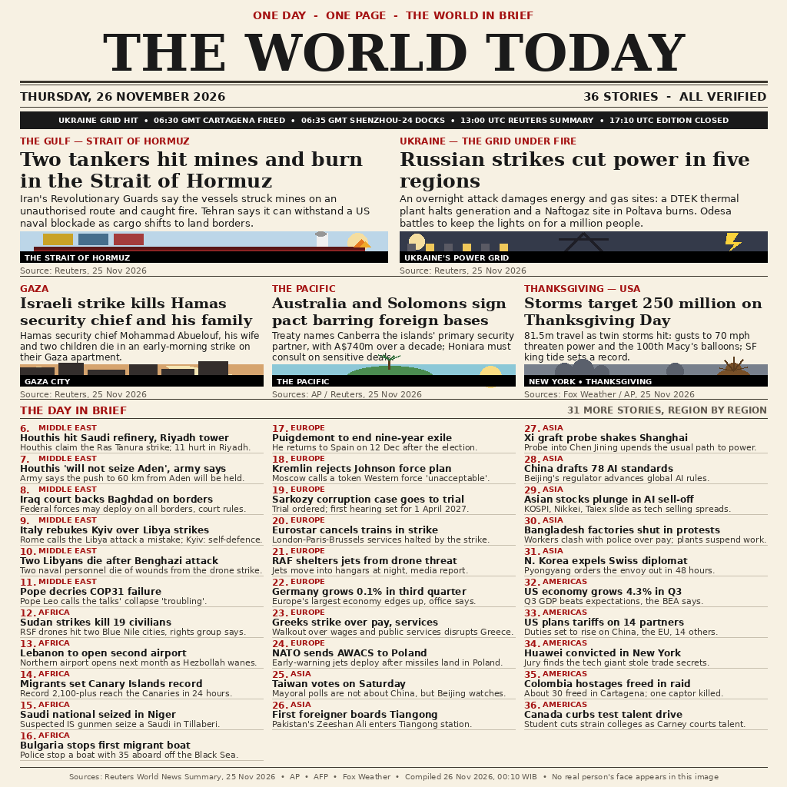

# THE WORLD TODAY — 26 November 2026

[](https://make.fun/bounty/news-image-20261126)
[](https://make.fun/bounty/news-image-20261126)
[](https://make.fun/bounty/news-image-20261126)

One day of real world news in a single 1024×1024 front page, drawn
programmatically with Python + Pillow. No external images, no real
person's face. **36 stories**: 5 lead stories with flat illustrations
plus 31 briefs with region labels, a UTC timeline strip, and a source
line on every story. Every story comes from the Reuters World News
Summary of 25 November 2026 (the 26 November edition in Asia) and
from AP, AFP and Fox Weather reports of the same day — see NOTES.md
for the source of each story.



## The 5 lead stories

1. **Two tankers hit mines and burn in the Strait of Hormuz** — Iran's
   Revolutionary Guards say the vessels struck mines on an unauthorised
   route; Tehran says it can withstand a US naval blockade. (Reuters)
2. **Russian strikes cut power in five regions** — overnight attack
   damages energy and gas sites; Odesa battles to keep the lights on.
   (Reuters)
3. **Israeli strike kills Hamas security chief and his family** —
   Mohammad Abuelouf, his wife and two children die in Gaza. (Reuters)
4. **Australia and Solomons sign pact barring foreign bases** — treaty
   names Canberra the islands' primary security partner, A$740m over a
   decade. (AP / Reuters)
5. **Storms target 250 million on Thanksgiving Day** — 81.5m Americans
   travel as twin coastal storms hit; gusts to 70 mph, the 100th Macy's
   parade balloons at risk, a record king tide in San Francisco.
   (Fox Weather / AP)

Plus 31 briefs: Middle East 6, Africa 5, Europe 8, Asia 7, Americas 5 —
Houthi strikes on Saudi Arabia, Puigdemont's return, Sarkozy's trial,
the first foreigner aboard Tiangong, US GDP at 4.3%, and more.

## Run

The grader runs `main.py` with the standard library only, so it just
copies the finished `entry.png` into the output directory:

```sh
MAKEFUN_OUTPUT_DIR=/tmp/news26-out python3 main.py
```

Writes only `entry.png` into that directory (default `/output`).
Deterministic: two runs produce byte-identical output.

`draw.py` is the local build tool that painted `entry.png` (needs
Pillow on the author's machine). The grader never runs it.

## Image

- 1024×1024 PNG, 191,113 bytes (limit 1 MiB)
- sha256: `dc358b129e2d5afa075578d6fcc3abf76cf06aa29cf2483075bdc4c5d6081219`
- 36 stories, ink 25.0%
